<p align="center"></p>

<h1 align="center">Smart Life Planner</h1>
<p align="center"><b>Pakistan Trip Planner &amp; Monthly Budget Manager</b><br>
<i>Plan the trip. Understand the cost. Track the month. Export the report.</i></p>

<p align="center">

[](https://laiba-shehbaz.github.io/python-smart-life-planner/preview.html)

</p>
<p align="center">


</p>

<p align="center"><a href="#quick-start">Quick start</a> &nbsp;·&nbsp; <a href="#2-features">Features</a> &nbsp;·&nbsp; <a href="#16-testing-and-results">Tests</a> &nbsp;·&nbsp; <a href="#15-pdf-generation">PDF reports</a> &nbsp;·&nbsp; <a href="#17-edge-case-traceability-matrix">Edge cases</a></p>

<table align="center">
<tr><td><b>Repository</b></td><td><code>python-smart-life-planner</code></td></tr>
<tr><td><b>Stack</b></td><td>Python 3.10+ &nbsp;|&nbsp; Pytest &nbsp;|&nbsp; reportlab &nbsp;|&nbsp; JSON persistence</td></tr>
</table>

## ▶ Try it live (no installation)

The live demo is a single HTML page (`smart-life-planner.html`, hosted separately on GitHub Pages and not part of this repository) that runs the **same formulas, validation and ranking rules** as the Python application, directly in the browser. I compared it with the Python code on 500 random trips (every valid trip gave an identical total) and on 300 over-budget scenarios (696 ranked alternatives, all identical).

| What to try | How |
|---|---|
| Start | An animated **Smart Life Planner** splash opens, then the home screen shows three widgets: *Pakistan Trip Planner*, *Monthly Budget Manager* and *Past Records* |
| Open a module | Tap a widget, **enter your name** (it is printed as "Prepared by" on the PDF), then the module opens |
| Plan a trip | Press **Calculate / propose plan** (default: Hunza, 4 travellers, PKR 150,000) |
| See why it is unaffordable | Read the shortage, minimum budget, maximum travellers and the ranked alternatives; press **Apply** on one |
| Test validation | Type `abc`, `-5`, an empty value, or nights greater than days |
| Pending vs confirmed | Change a field → **Calculate** → review the before/after table → **Confirm** or **Cancel** |
| Manage a month | *Budget Manager* → create a budget, edit planned amounts, add custom categories and expenses |
| Download a PDF | Confirm the plan or budget, then press **⬇ Download PDF report**. On a phone use **Share / Save to Files** or **Download** in the box that appears |
| Past records | *Past Records* lists saved trips, budgets and every PDF you generated: reopen, re-download, export / import as JSON, delete |
| Theme | Light gradient by default; the top-right button switches to dark (text contrast checked in both) |

<p align="center"></p>

**PDFs downloaded from the live demo** (real PDF files with a centred developer footer and page numbers on every page):

<p align="center">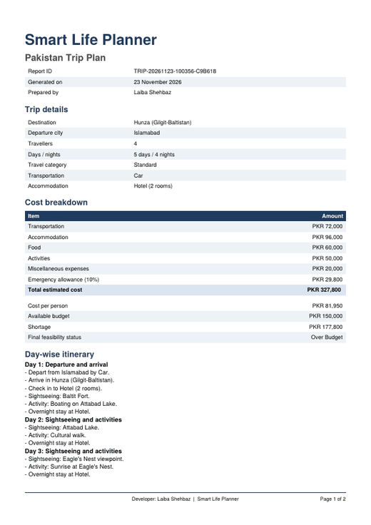</p>

> **Publishing the demo:** upload `smart-life-planner.html` to the root of your GitHub Pages repository (here `laiba-shehbaz/laiba-shehbaz`) and enable *Settings → Pages → Deploy from branch*. The demo stores data only in your own browser (localStorage); nothing is uploaded. The browser PDF is a lightweight export; the full reportlab report is produced by the Python application.

## Quick start
```bash
git clone https://github.com/<your-username>/python-smart-life-planner.git
cd python-smart-life-planner
pip install -r requirements.txt
python main.py            # run the application
python -m pytest -q       # run the 386 tests
```

---

## Table of contents
0. [Live demo](#-try-it-live-no-installation) · [Quick start](#quick-start)
1. [Overview and problem statement](#1-overview-and-problem-statement)
2. [Features](#2-features)
3. [System design (diagrams)](#3-system-design)
4. [Methodology: how the calculations work](#4-methodology-how-the-calculations-work)
5. [Intelligent feasibility checking and optimisation](#5-intelligent-feasibility-checking-and-optimisation)
6. [Destination database and cost assumptions](#6-destination-database-and-cost-assumptions)
7. [Monthly Budget Manager](#7-monthly-budget-manager)
8. [Folder structure](#8-folder-structure)
9. [Python concepts used](#9-python-concepts-used)
10. [OOP classes and responsibilities](#10-oop-classes-and-responsibilities)
11. [Collections used and why](#11-collections-used-and-why)
12. [Data persistence](#12-data-persistence)
13. [Installation and execution](#13-installation-and-execution)
14. [Developer configuration](#14-developer-configuration)
15. [PDF generation](#15-pdf-generation)
16. [Testing and results](#16-testing-and-results)
17. [Edge-case traceability matrix](#17-edge-case-traceability-matrix)
18. [Requirement checklist](#18-requirement-checklist)
19. [Sample terminal output](#19-sample-terminal-output)
20. [Limitations and future work](#20-limitations-and-future-work)

---

## 1. Overview and problem statement
People often choose a trip first and only later discover it is unaffordable, without knowing *why* or *what to change*. Household budgets fail in a similar way: money is planned, but overspending is noticed only at month-end.

**Smart Life Planner** is a menu-driven Python application that solves both problems with two integrated modules:

| Module | Purpose |
|---|---|
| **Pakistan Trip Planner** | Estimates the full cost of a trip, classifies it against the budget, explains any shortage, *calculates* realistic alternatives, supports safe modification, and produces a day-wise itinerary. |
| **Monthly Budget Manager** | Tracks planned vs actual spending per category, savings, savings %, and overspending for *Home & Kitchen* or *Personal Finance* budgets. |

Both modules validate every input, save records to JSON, and create a professional **PDF report (reportlab) only after the user confirms** the plan or budget.

> **Important:** all destination costs are **estimates, not guaranteed market prices.** Real prices vary by season, availability and provider.

## 2. Features
- **Trip planning:** 10 destinations, separate *days* and *nights* (zero-night trips allowed), travel categories (Budget / Standard / Premium), transport and accommodation preferences, departure city.
- **Feasibility:** *Within Budget*, *Exactly Within Budget*, *Over Budget* with exact shortage / remaining amounts.
- **Optimisation:** increase budget, reduce travellers, reduce duration, change destination, adjust preferences, and a ranked comparison, all recalculated from scratch.
- **Dynamic modification:** change any parameter(s) without restarting; review a before→after diff; confirm or cancel. Cancelled / unconfirmed changes never overwrite the confirmed plan.
- **Itinerary:** adapts to the real number of days and nights.
- **Budgeting:** create budgets, add/rename/remove (custom) categories, set planned amounts, record/update/delete expenses, category-wise views, totals, remaining balance, savings %, overspending flags.
- **Reports:** trip and monthly PDFs with heading, date, unique report ID, tables, PKR formatting, page numbers and a developer footer on every page; previous-report index.
- **Safety:** input validation, safe handling of missing/empty/corrupt JSON, duplicate-filename protection, and understandable error messages.

## 3. System design

### 3.1 Architecture
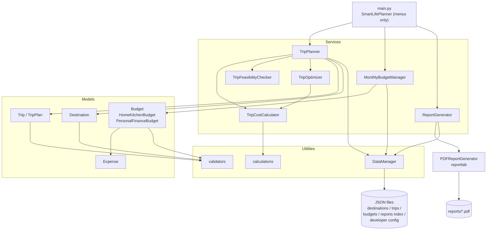

### 3.2 Main menu structure
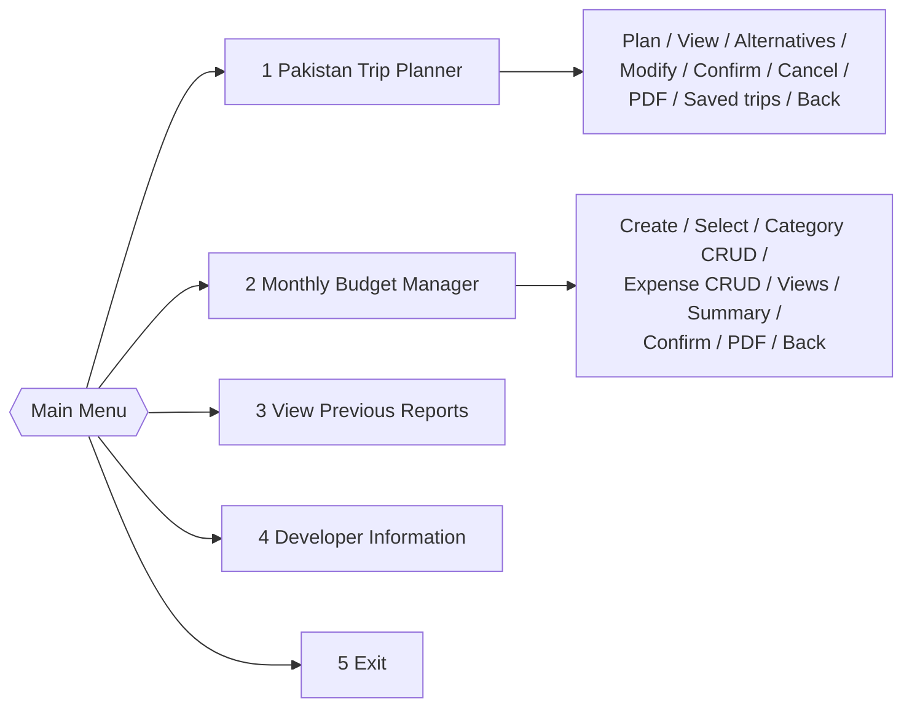
The loop runs until *Exit* is chosen; invalid options re-prompt, and end-of-input (Ctrl-D / Ctrl-C) exits cleanly. Exiting with unconfirmed trip changes asks for confirmation first.

### 3.3 Trip plan life-cycle (pending vs confirmed)
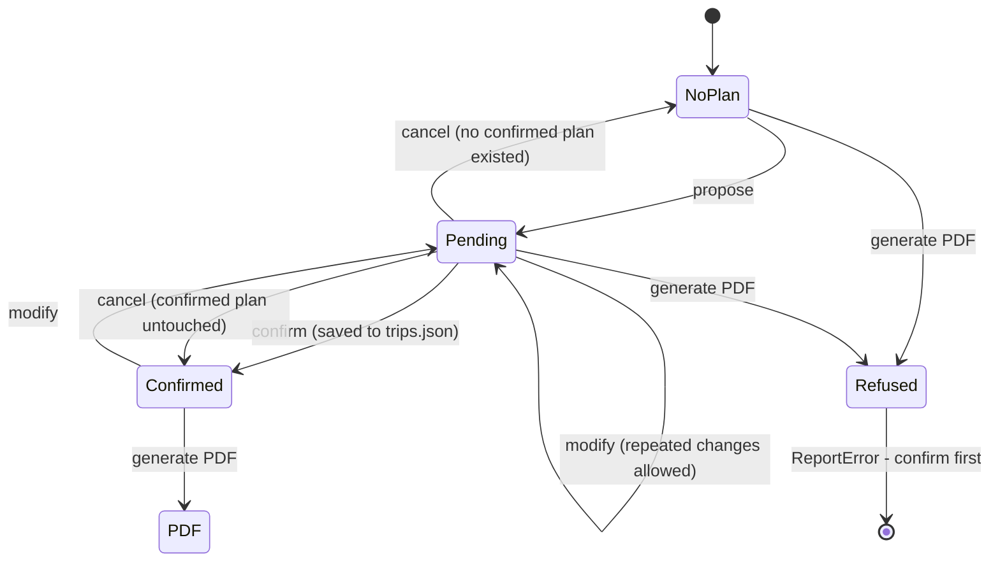
`TripPlanner` keeps two separate slots (`confirmed` and `pending`). Only `confirm()` copies pending → confirmed, so a cancelled or abandoned change can never overwrite the previous plan.

### 3.4 Optimisation flow
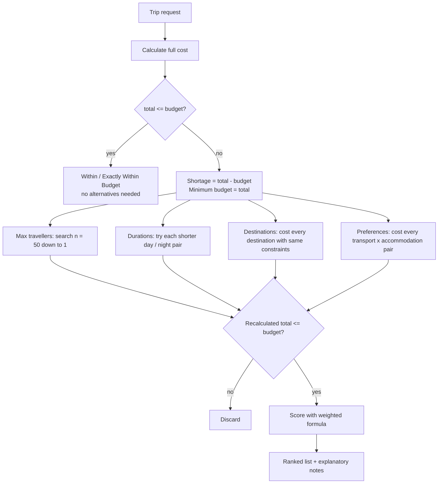

### 3.5 Monthly budget workflow
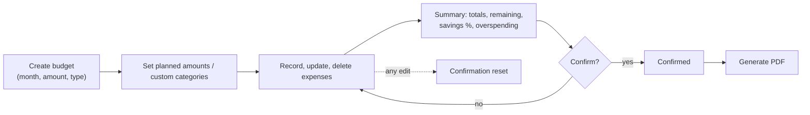

### 3.6 Class diagram (simplified)
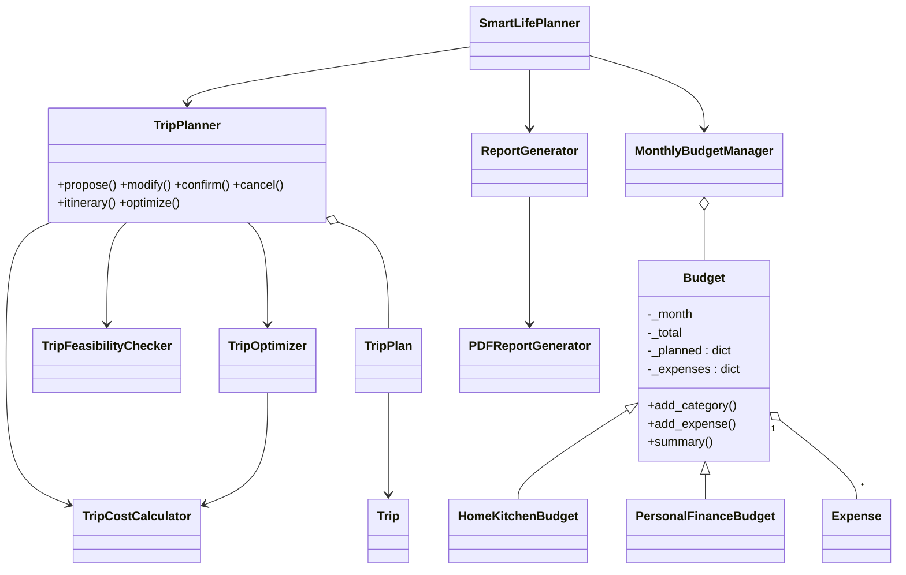

## 4. Methodology: how the calculations work
Every figure is an **integer number of rupees**, so comparisons at the PKR 1 boundary are exact.

| Quantity | Formula |
|---|---|
| Transport | `round(transport_pp × mode_factor × city_factor) × travellers` |
| Rooms | `ceil(travellers ÷ room_capacity)` |
| Accommodation | `round(room_rate × accommodation_factor) × rooms × nights` (**0 when nights = 0**) |
| Food | `round(food_pp_day × category_factor) × travellers × days` |
| Activities / Misc | same pattern as food |
| Subtotal | transport + accommodation + food + activities + misc |
| Emergency allowance | `ceil(subtotal × 10 %)` (percentage configurable) |
| **Total** | subtotal + emergency |
| Cost per person | `total ÷ travellers` (2 decimals) |
| Difference | `budget − total` → remaining (≥ 0) or shortage (< 0) |

Factors (all editable in `data/destinations.json`):

| Factor | Values |
|---|---|
| Transport mode | Bus ×0.6, Car ×1.0, Flight ×2.4 |
| Accommodation type | Guest House ×0.5, Hotel ×1.0, Resort ×1.9 |
| Travel category (food/activities/misc) | Budget ×0.7, Standard ×1.0, Premium ×1.6 |
| Category defaults when preference is "auto" | Budget → Bus + Guest House; Standard → Car + Hotel; Premium → Car + Resort |
| Departure city (transport) | Islamabad/Rawalpindi ×1.0, Peshawar ×1.1, Lahore ×1.25, Faisalabad ×1.35, Multan ×1.6, Quetta ×2.0, Karachi ×2.2; local travel (same city or Rawalpindi↔Islamabad) ×0.15 |

**Assumptions:** days and nights are independent (`0 ≤ nights ≤ days`); food, activities and misc are charged per *day*, accommodation per *night*; limits are 1–50 travellers and 1–30 days; a destination that does not offer the chosen category, transport or accommodation is rejected rather than silently substituted; the emergency allowance is part of the cost, so it can turn an otherwise affordable trip into an unaffordable one.

**Feasibility rule:** `Within Budget` if total < budget, `Exactly Within Budget` if total = budget, `Over Budget` if total > budget.

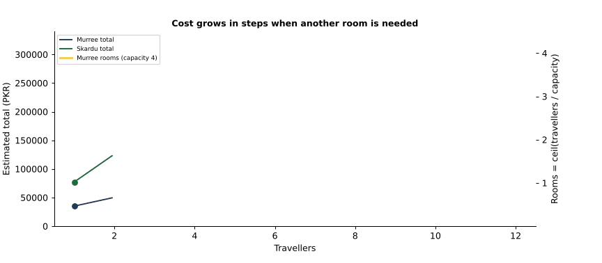

*The chart above is produced by the real code: each extra room (when travellers exceed a multiple of the room capacity) causes a step in the total.*

## 5. Intelligent feasibility checking and optimisation
`TripOptimizer` never hard-codes advice. For an over-budget trip it **re-runs the full cost calculation** for every candidate and keeps only candidates whose complete total (including emergency allowance) is ≤ the budget.

| Option | How it is calculated |
|---|---|
| 1. Increase budget | minimum required = recalculated total; additional = total − budget |
| 2. Reduce travellers | largest n (50 → 1) whose recalculated total fits |
| 3. Reduce duration | for each shorter day count, the largest night count (≤ original) that fits |
| 4. Change destination | cost *every* destination (respecting the chosen destination type, category and preferences) |
| 5. Adjust preferences | cost every transport × accommodation pair the destination offers |
| 6. Compare / rank | weighted score of all feasible plans |

**Ranking score** = 0.25·destination preference (same = 1.0, same category = 0.6, other = 0.3) + 0.25·travellers kept + 0.20·days kept + 0.15·remaining-budget share + 0.15·preferences kept; ties are broken by lower cost.

If nothing fits, the report says exactly why (e.g. *budget cannot cover even one traveller*, *even a 1-day trip is unaffordable*, *no other destination is affordable*) and still states the minimum budget required.

### Worked example (real output of the code)
| Item | Value |
|---|---|
| Trip | Hunza, 4 travellers, 5 days / 4 nights, Standard, from Islamabad |
| Total estimate | PKR 327,800 |
| Available budget | PKR 150,000 |
| Status | Over Budget |
| Shortage | PKR 177,800 |
| Minimum budget required | PKR 327,800 |
| Additional budget needed | PKR 177,800 |
| Maximum travellers within budget | 1 |

Ranked alternatives (each one fully recalculated and ≤ PKR 150,000):

<p align="center"></p>

<details><summary>Show this table as text</summary>

| Rank | Alternative | Complete cost | Remaining | Score |
|---|---|---|---|---|
| 1 | Change destination to Murree | PKR 134,200 | PKR 15,800 | 0.7658 |
| 2 | Shorten trip to 2 days / 0 nights | PKR 136,400 | PKR 13,600 | 0.7436 |
| 3 | Shorten trip to 1 day / 1 night | PKR 134,200 | PKR 15,800 | 0.7058 |
| 4 | Reduce travellers to 1 | PKR 108,350 | PKR 41,650 | 0.7042 |
| 5 | Change destination to Taxila | PKR 123,200 | PKR 26,800 | 0.7018 |

</details>

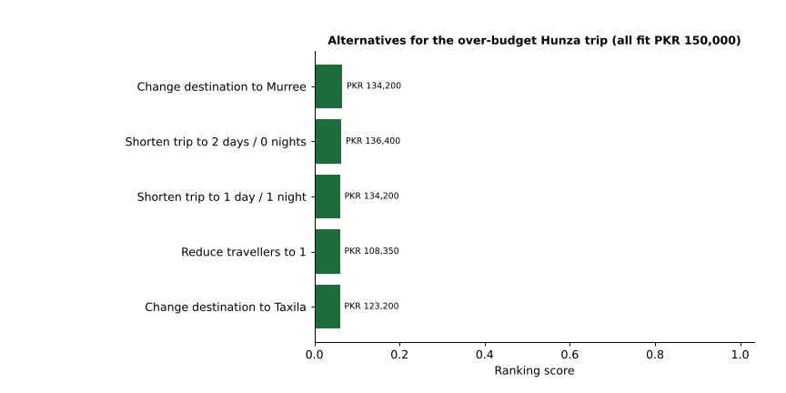

## 6. Destination database and cost assumptions
Stored in [`data/destinations.json`](data/destinations.json) (with the disclaimer in the file itself). Each record has name, region, category, transport cost per person, accommodation cost per room/night, food cost per person/day, activities and miscellaneous costs, room capacity, and the relevant travel categories, transport modes and accommodation types. Invalid records (missing/negative/non-numeric costs) are skipped with a warning instead of crashing.

| Destination | Region | Category | Transport /person | Room /night | Food /person/day | Activities /person/day | Misc /person/day | Room capacity |
|---|---|---|---|---|---|---|---|---|
| Hunza | Gilgit-Baltistan | Mountains | 18,000 | 12,000 | 3,000 | 2,500 | 1,000 | 3 |
| Islamabad | Islamabad Capital Territory | Lakes & Nature | 2,000 | 10,000 | 3,000 | 1,000 | 800 | 3 |
| Kalam | Khyber Pakhtunkhwa | Lakes & Nature | 11,000 | 11,000 | 2,800 | 1,800 | 900 | 3 |
| Lahore | Punjab | Historical Places | 9,000 | 9,000 | 2,800 | 1,200 | 800 | 4 |
| Murree | Punjab | Mountains | 2,500 | 9,000 | 2,500 | 800 | 500 | 4 |
| Naran | Khyber Pakhtunkhwa | Lakes & Nature | 10,000 | 10,500 | 2,800 | 2,000 | 900 | 4 |
| Nathiagali | Khyber Pakhtunkhwa | Mountains | 3,500 | 9,500 | 2,500 | 800 | 600 | 3 |
| Skardu | Gilgit-Baltistan | Mountains | 22,000 | 13,000 | 3,200 | 3,000 | 1,200 | 3 |
| Swat | Khyber Pakhtunkhwa | Lakes & Nature | 9,000 | 10,000 | 2,800 | 1,500 | 800 | 3 |
| Taxila | Punjab | Historical Places | 3,000 | 7,000 | 2,200 | 900 | 500 | 4 |

*Baseline = Car + Hotel, from Islamabad, Standard category. Nathiagali is offered only for Standard/Premium; Taxila only has Guest House/Hotel.*

### Cost of one reference trip at every destination
Reference trip: **2 travellers, 3 days / 2 nights, Standard, from Islamabad** (values computed by the application):

<p align="center"></p>

<details><summary>Show this table as text</summary>

| Destination | Transport | Accommodation | Food | Activities | Misc | Emergency | Total | Per person |
|---|---|---|---|---|---|---|---|---|
| Taxila | 6,000 | 14,000 | 13,200 | 5,400 | 3,000 | 4,160 | **45,760** | 22,880.00 |
| Murree | 5,000 | 18,000 | 15,000 | 4,800 | 3,000 | 4,580 | **50,380** | 25,190.00 |
| Islamabad | 600 | 20,000 | 18,000 | 6,000 | 4,800 | 4,940 | **54,340** | 27,170.00 |
| Nathiagali | 7,000 | 19,000 | 15,000 | 4,800 | 3,600 | 4,940 | **54,340** | 27,170.00 |
| Lahore | 18,000 | 18,000 | 16,800 | 7,200 | 4,800 | 6,480 | **71,280** | 35,640.00 |
| Swat | 18,000 | 20,000 | 16,800 | 9,000 | 4,800 | 6,860 | **75,460** | 37,730.00 |
| Naran | 20,000 | 21,000 | 16,800 | 12,000 | 5,400 | 7,520 | **82,720** | 41,360.00 |
| Kalam | 22,000 | 22,000 | 16,800 | 10,800 | 5,400 | 7,700 | **84,700** | 42,350.00 |
| Hunza | 36,000 | 24,000 | 18,000 | 15,000 | 6,000 | 9,900 | **108,900** | 54,450.00 |
| Skardu | 44,000 | 26,000 | 19,200 | 18,000 | 7,200 | 11,440 | **125,840** | 62,920.00 |

</details>

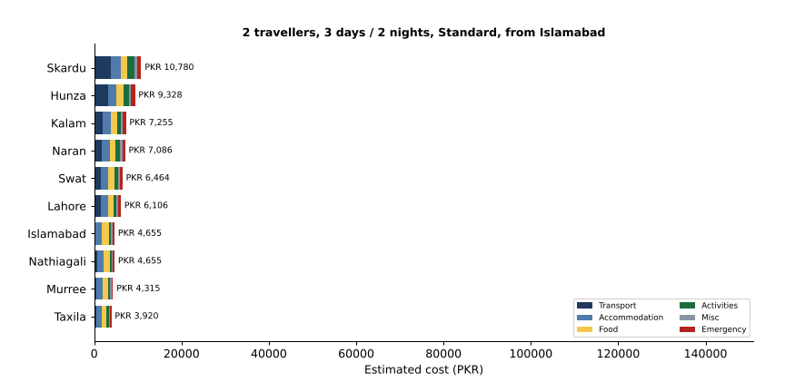

## 7. Monthly Budget Manager
- **Budget types:** *Home & Kitchen* (Grocery, Electricity, Gas, Water, Internet, Rent, Kitchen Supplies, Medical Expenses, Transportation, Emergency Savings, Other Expenses) and *Personal Finance* (Cosmetics and Personal Care, Fitness and Gym, Health and Medical, Shopping, Clothing, Food and Restaurants, Transportation, Education, Entertainment, Investments and Savings, Other Expenses). Custom categories can be added to either.
- **Definitions:** `remaining = available − actual`; `savings = max(0, remaining)`; `savings % = savings ÷ available × 100`; `unallocated = available − planned`; a category is *overspent* when `actual > planned` (spending in an unplanned category counts); the budget is *overspent* when `actual > available`.
- **Rules:** category names are unique (case-insensitive); expense IDs are unique (auto-generated `E001…` when omitted); expense dates must fall in the budget month; a category with expenses cannot be removed; planned totals above the available amount are allowed but warned about; any edit resets the confirmation.

<details><summary>Show this table as text</summary>

| Category | Planned | Actual | Difference |
|---|---|---|---|
| Grocery | PKR 30,000 | PKR 32,500 | -PKR 2,500 |
| Electricity | PKR 12,000 | PKR 14,200 | -PKR 2,200 |
| Internet | PKR 4,000 | PKR 4,000 | PKR 0 |
| Rent | PKR 50,000 | PKR 50,000 | PKR 0 |
| Emergency Savings | PKR 10,000 | PKR 0 | PKR 10,000 |

</details>

| Measure | Value |
|---|---|
| Available | PKR 120,000 |
| Total planned | PKR 106,000 |
| Total actual | PKR 100,700 |
| Remaining balance | PKR 19,300 |
| Savings | PKR 19,300 (16.08%) |
| Unallocated | PKR 14,000 |
| Overspent categories | Grocery (+PKR 2,500), Electricity (+PKR 2,200) |

<p align="center"></p>

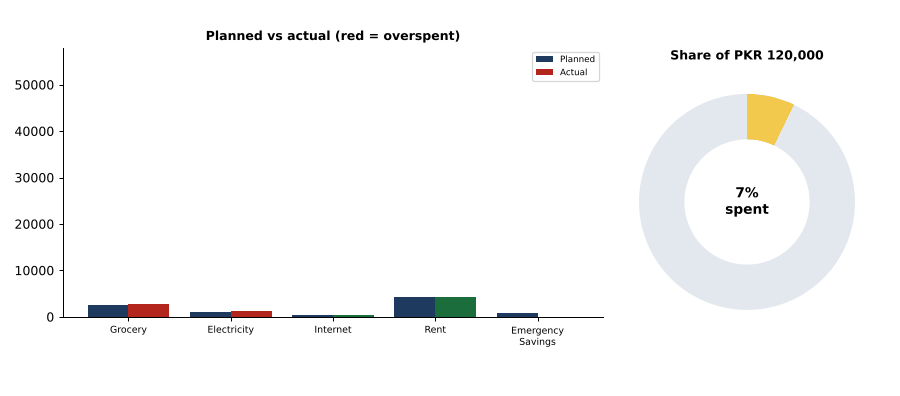

## 8. Folder structure
```
python-smart-life-planner/
├── main.py                      # SmartLifePlanner: menu-driven entry point
├── config/developer.json        # developer name, GitHub username, email
├── models/                      # destination.py, trip.py, expense.py, budget.py
├── services/                    # trip_planner, trip_calculator, feasibility_checker,
│                                # trip_optimizer, budget_manager, report_generator
├── utils/                       # validators, calculations, constants, data_manager
├── pdf/pdf_generator.py         # reportlab PDF layout + footer on every page
├── data/
│   ├── destinations.json        # destination database (committed)
│   ├── trips.json  budgets.json  reports_index.json   # private records (git-ignored)
│   └── samples/                 # empty sample/placeholder records
├── reports/.gitkeep             # generated PDFs go here (git-ignored)
├── tests/                       # 10 test modules + conftest.py (fixtures)
├── docs/
│   ├── images/                  # banner and charts (generated from real code)
│   ├── screenshots/             # sample PDFs + PNG previews
│   └── generate_assets.py       # regenerates every chart/table in this README
├── requirements.txt             # pytest, reportlab
├── requirements-docs.txt        # matplotlib, pytest-cov (documentation only)
├── .gitignore
└── README.md
```
Private financial records and generated PDFs are git-ignored; the application creates the missing files on first run.

## 9. Python concepts used
| Concept | Where |
|---|---|
| Variables and data types | constants, settings, all models |
| Conditions and loops | menus, optimiser searches, itinerary generation |
| Functions / reusable calculations | `utils/calculations.py`, `utils/validators.py` |
| String handling and formatting | `format_pkr`, f-strings, table/report text, name normalisation |
| Lists, dicts, sets, tuples | immutable tuple fields on `Destination`; `set` difference in `modify()`; dict-based settings |
| Comprehensions | category rows, record filtering, settings validation |
| File handling and exceptions | `DataManager`; `ValidationError`, `DataError`, `ReportError`, `PDFGenerationError` |
| OOP | encapsulation (private attributes + properties), inheritance (`Budget` subclasses), frozen dataclasses, factory function |
| `collections` | see section 11 |
| Automated testing | Pytest with fixtures, `tmp_path`, `parametrize`, `monkeypatch` |

## 10. OOP classes and responsibilities
| Class | Responsibility |
|---|---|
| `Destination` | Validated, immutable destination and cost data |
| `Trip` / `TripPlan` | Validated trip request / request + costs + feasibility |
| `TripCostCalculator` | All trip cost formulas |
| `TripFeasibilityChecker` | Status classification, shortage/remaining, explanation |
| `TripOptimizer` | Dynamic alternatives, scoring, ranking, "no option" notes |
| `TripPlanner` | Pending vs confirmed plans, modify/confirm/cancel, itinerary, diff |
| `Expense` | One validated expense (encapsulated fields) |
| `Budget`, `HomeKitchenBudget`, `PersonalFinanceBudget` | Categories, expenses and all budget calculations (inheritance) |
| `MonthlyBudgetManager` | Owns all budgets, recent-activity history, save/load |
| `ReportGenerator` | Summaries, unique report IDs/filenames, confirmation gate, report index |
| `PDFReportGenerator` | reportlab layout, tables, footer, page numbers |
| `DataManager` | All JSON I/O, corruption handling, developer configuration |
| `SmartLifePlanner` | Menus and input loop only; delegates everything else |

## 11. Collections used and why
| Structure | Used in | Why |
|---|---|---|
| `namedtuple` | `CostBreakdown`, `FeasibilityResult`, `AlternativePlan`, `CategoryRow`, `ItineraryDay`, `DestinationComparison`, `DestinationData` | readable, immutable records instead of anonymous tuples |
| `Counter` | `Budget.actual_by_category()` | totals per category; unknown categories safely read as 0 |
| `defaultdict(list)` | `Budget.expenses_by_category()` | groups expenses without key checks |
| `deque(maxlen=…)` | `TripPlanner.history`, `MonthlyBudgetManager.activity` | bounded "recent activity" log |

## 12. Data persistence
JSON files, separated from application logic in `utils/data_manager.py`: destinations (+ settings), confirmed trip plans, budgets (with expenses), a report index, and developer configuration. Files are loaded at start-up. Missing or empty files give empty records; corrupted JSON is ignored with a warning; invalid individual records are skipped; writes are atomic (temp file → replace) and create missing folders.

## 13. Installation and execution
```bash
git clone https://github.com/<your-username>/python-smart-life-planner.git
cd python-smart-life-planner
python -m venv .venv
source .venv/bin/activate          # Windows: .venv\Scripts\activate
pip install -r requirements.txt
python main.py
```

## 14. Developer configuration
Edit `config/developer.json` with **your own** details (never passwords or API keys):
```json
{
  "developer_name": "Your Name",
  "github_username": "your-github-username",
  "email": "your-email@example.com"
}
```
These appear in the footer of every PDF page. If the file is missing, incomplete or has an invalid email, the application still runs, shows a warning and prints "Not provided" in the footer.

## 15. PDF generation
1. Trip: *Pakistan Trip Planner → Confirm plan → Generate trip PDF*.
2. Budget: *Monthly Budget Manager → Confirm budget → Generate budget PDF*.

PDFs are saved in `reports/` as e.g. `TRIP-20261122-064646-CF9D7B.pdf` (unique ID; an existing file is never overwritten) and listed under *View Previous Reports*. Trip PDFs include heading, date, report ID, trip details, preferences, full cost breakdown, total, cost per person, budget, remaining/shortage, status and the day-wise itinerary. Budget PDFs include month, type, available amount, a category-wise planned/actual/difference table, totals, remaining balance, savings and %, overspent categories and unallocated amount. Every page has page numbers and the developer footer.

<p align="center">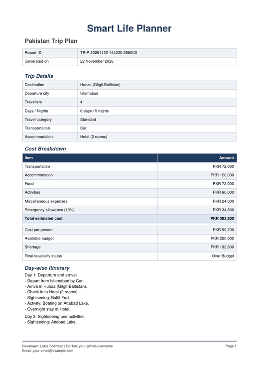</p>

The **live demo** also downloads real PDFs (confirm first, then *Download PDF report*).

Sample files: [`sample_trip_report.pdf`](docs/screenshots/sample_trip_report.pdf), [`sample_budget_report.pdf`](docs/screenshots/sample_budget_report.pdf) (footer shows the author name; GitHub username and email are still the placeholders from `config/developer.json`).

## 16. Testing and results
```bash
python -m pytest -v                                   # run all tests
pip install -r requirements-docs.txt
python -m pytest --cov=models --cov=services --cov=utils --cov=pdf --cov=main   # coverage
```
**Latest run of this project:** `386 passed in 1.35s`, **97% statement coverage** (measured with pytest-cov by `docs/generate_assets.py`).

<p align="center"></p>

| Test file | Tests |
|---|---|
| test_budget_manager.py | 44 |
| test_data_manager.py | 31 |
| test_feasibility_checker.py | 16 |
| test_main_menu.py | 27 |
| test_models_and_helpers.py | 77 |
| test_pdf_generator.py | 28 |
| test_trip_calculator.py | 20 |
| test_trip_optimizer.py | 17 |
| test_trip_planner.py | 51 |
| test_validators.py | 75 |
| **Total** | **386** |

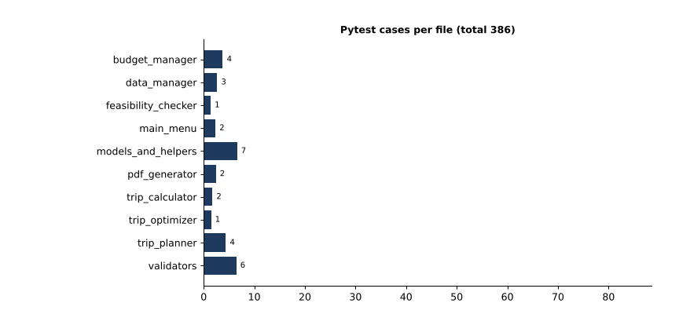

`test_models_and_helpers.py` adds model validation/immutability, calculation-helper, itinerary edge-case, planner, optimiser-scoring, persistence and report-text tests on top of the module tests.

**Testing rules followed:** `pytest` assertions; meaningful names; `pytest.mark.parametrize` for input scenarios; fixtures in `tests/conftest.py` (including small deterministic destinations so hand-calculated expectations are independent of editable prices); `tmp_path` for every file/PDF test; real user data is never modified; tests call the real application logic. PDFs are written uncompressed so tests can read amounts, report IDs and footers directly from the file without extra libraries; footer tests count the footer once **per page**.

Coverage per module:

| Module | Coverage |
|---|---|
| main.py | 95% |
| models/budget.py | 97% |
| models/destination.py | 100% |
| models/expense.py | 97% |
| models/trip.py | 100% |
| pdf/pdf_generator.py | 99% |
| services/budget_manager.py | 100% |
| services/feasibility_checker.py | 100% |
| services/report_generator.py | 97% |
| services/trip_calculator.py | 100% |
| services/trip_optimizer.py | 91% |
| services/trip_planner.py | 99% |
| utils/calculations.py | 100% |
| utils/constants.py | 100% |
| utils/data_manager.py | 96% |
| utils/validators.py | 97% |
| **Total** | **97%** |

## 17. Edge-case traceability matrix
Every boundary in the assessment brief (section 10) maps to at least one automated test (test names verified to exist).

| Brief requirement | Test(s) |
|---|---|
| Empty / non-numeric / zero / negative budget | `test_parse_budget_rejects_invalid`, `test_invalid_trip_inputs_are_rejected` |
| Invalid travellers / days / nights | `test_parse_travellers_rejects_invalid`, `test_parse_days_rejects_invalid`, `test_parse_nights_against_days` |
| Invalid menu options | `test_menu_choice_rejects_invalid_options`, `test_invalid_menu_options_are_rejected_then_app_continues` |
| Unknown destination / invalid category | `test_unknown_destination_raises`, `test_unsupported_category_for_destination_raises`, `test_parse_choice_rejects_unknown_and_empty` |
| Negative / non-numeric expenses | `test_invalid_expense_amounts_rejected` |
| Maximum traveller / duration limits | `test_traveller_limits_are_inclusive`, `test_maximum_traveller_limit_is_accepted` |
| Budget = cost, ±PKR 1 | `test_exact_budget_boundary`, `test_one_rupee_below_is_over_budget`, `test_one_rupee_above_is_within_budget` |
| Budget below one traveller | `test_budget_insufficient_for_one_traveller` |
| Minimum duration unaffordable | `test_minimum_duration_still_unaffordable` |
| No affordable destination | `test_no_destination_affordable` |
| Emergency allowance tips budget | `test_emergency_allowance_can_make_trip_unaffordable` |
| Multiple rooms | `test_rooms_required_uses_ceiling`, `test_multiple_rooms_scale_accommodation` |
| Zero-night trip | `test_zero_night_trip_has_zero_accommodation`, `test_zero_night_itinerary_has_no_check_in` |
| One-person affordability | `test_one_person_trip_is_affordable_with_small_budget` |
| Missing / invalid destination cost data | `test_invalid_destination_records_are_skipped_with_errors` |
| Repeated budget changes | `test_repeated_budget_changes_flip_status` |
| Destination change after recommendations | `test_destination_change_after_recommendations` |
| Multiple parameters at once | `test_modify_multiple_parameters_at_once` |
| Cancel / confirm adjustments | `test_cancelled_changes_preserve_previous_confirmed_plan`, `test_confirmed_changes_replace_plan_and_are_saved` |
| Exit without confirming | `test_unconfirmed_modification_does_not_overwrite_confirmed`, `test_exit_with_pending_changes_can_be_declined` |
| Alternatives are calculated, not hard-coded | `test_alternatives_are_calculated_not_hardcoded`, `test_every_recommended_alternative_fits_budget` |
| Zero / negative monthly budget | `test_invalid_monthly_amounts_rejected` |
| Negative planned amount | `test_negative_planned_amount_rejected` |
| Planned exceeds budget | `test_planned_exceeds_budget_is_flagged` |
| Actual exceeds category / total | `test_category_overspending_detected`, `test_overall_overspending_and_zero_savings` |
| Duplicate categories / expense IDs | `test_add_custom_category_and_reject_duplicates`, `test_duplicate_and_invalid_expense_ids` |
| Missing expense ID | `test_auto_ids_are_unique_after_deletion` |
| Update/delete nonexistent expense | `test_nonexistent_expense_update_and_delete` |
| No expense records | `test_empty_expenses` |
| Zero savings / all money allocated | `test_exactly_all_money_spent_gives_zero_savings` |
| Invalid custom category | `test_invalid_custom_categories_rejected` |
| Missing / empty / corrupt JSON | `test_missing_empty_or_corrupt_destination_file_gives_empty_list`, `test_corrupt_json_adds_warning`, `test_corrupted_saved_trips_are_handled_safely` |
| Save and load | `test_save_and_load_trip_records`, `test_manager_saves_and_loads`, `test_round_trip_serialisation` |
| Missing reports directory | `test_missing_reports_directory_is_created`, `test_reports_directory_created_when_missing` |
| PDF generation failure | `test_pdf_write_failure_is_wrapped`, `test_report_error_wraps_pdf_failure` |
| Missing developer info / email | `test_developer_config_missing_or_incomplete_uses_placeholders`, `test_developer_invalid_email_is_replaced_and_reported`, `test_missing_developer_info_uses_placeholder_in_footer` |
| PDF before confirmation | `test_trip_pdf_refused_before_confirmation` |
| Duplicate report filenames | `test_existing_reports_are_never_overwritten` |
| Footer on every page | `test_footer_on_every_page_of_multi_page_report` |
| PDF numbers match application | `test_trip_pdf_numbers_match_application_calculations`, `test_budget_pdf_contains_required_content_and_matches_calculations` |

## 18. Requirement checklist
| Area (marks) | Delivered |
|---|---|
| Trip Planner functionality (15) | all required inputs, 10 destinations in JSON, every required calculation, separate days/nights, itinerary |
| Feasibility and optimisation (15) | three statuses; increase budget, reduce travellers, reduce duration, change destination, adjust preferences, ranked comparison, all recalculated |
| Monthly Budget Manager (15) | both budget types, custom categories, category + expense CRUD, views, totals, remaining, savings %, overspending, reports, save/load |
| OOP design (10) | 13 single-responsibility classes, encapsulation, inheritance, factory |
| Collections and core Python (10) | `namedtuple`, `Counter`, `defaultdict`, `deque`; comprehensions, sets, tuples, file/exception handling |
| Validation, edge cases, exceptions (10) | section 17 |
| Pytest and boundary coverage (15) | 386 tests, 97% coverage |
| Persistence and PDF (5) | JSON persistence; reportlab PDFs after confirmation with developer footer on every page |
| GitHub and README (5) | required structure, `requirements.txt`, `.gitignore`, this README, incremental commits |

## 19. Sample terminal output
Captured from a real run of the application (trip: Hunza, 4 travellers, 5 days / 4 nights, budget PKR 150,000):
```text
Trip: Hunza from Islamabad | 4 traveller(s) | 5 days / 4 nights | Standard
  Transport (Car):   PKR 72,000
  Accommodation (Hotel, 2 room(s)): PKR 96,000
  Food:                 PKR 60,000
  Activities:           PKR 50,000
  Miscellaneous:        PKR 20,000
  Emergency allowance:  PKR 29,800
  TOTAL ESTIMATE:       PKR 327,800  (PKR 81,950 per person)
  Budget: PKR 150,000 | Shortage: PKR 177,800 | Status: Over Budget
  Estimated cost PKR 327,800 exceeds the budget PKR 150,000 by PKR 177,800.
Plan is PENDING. Use 'Confirm plan' to save it.
```
Menu option *Show feasibility alternatives*:
```text
Shortage: PKR 177,800
1. Increase budget: need PKR 327,800 (add PKR 177,800).
2. Reduce travellers: max 1 can travel within budget.
3. Reduce duration:
     Shorten trip to 2 days / 0 nights: PKR 136,400
     Shorten trip to 1 day / 1 night: PKR 134,200
4. Change destination:
     Change destination to Taxila: PKR 123,200
     Change destination to Murree: PKR 134,200
5. Adjust preferences: none affordable
6. Best alternatives (ranked):
     1. Change destination to Murree - PKR 134,200 (score 0.7658)
     2. Shorten trip to 2 days / 0 nights - PKR 136,400 (score 0.7436)
     3. Shorten trip to 1 day / 1 night - PKR 134,200 (score 0.7058)
     4. Reduce travellers to 1 - PKR 108,350 (score 0.7042)
     5. Change destination to Taxila - PKR 123,200 (score 0.7018)
```
Budget Manager: recording an expense and viewing the summary (rows with only zero values are abbreviated as `...`):
```text
Recorded E001: Grocery PKR 32,500
  Warning: Grocery is over its planned amount.
Home & Kitchen - 2026-11  | Available: PKR 120,000
  Category                           Planned        Actual    Difference
  Grocery                         PKR 30,000    PKR 32,500    -PKR 2,500
  ...
  Planned PKR 30,000 | Actual PKR 32,500 | Remaining PKR 87,500
  Savings PKR 87,500 (72.92%) | Unallocated PKR 90,000
  Overspent: Grocery (+PKR 2,500)
```

## 20. Limitations and future work
- All prices are **estimates**; the database is small (10 destinations) and uses simple multipliers rather than live fares or hotel rates.
- The itinerary is template-based from each destination's highlights and activities.
- The interface is a terminal menu; a Django or Flask web interface would be a natural extension (optional in the brief).
- Savings is defined as unspent money (`available − actual`); users who treat an "Investments and Savings" category as savings can read it from the category table.
- PDFs are intentionally uncompressed for testability; compression could be enabled for production use.
- The repository must be created and pushed by the student. `config/developer.json` carries the author name; the GitHub username and email are still placeholders (shown in the PDF footers) until they are filled in.

---
## Project information
| | |
|---|---|
| **Assessment** | Smart Life Planner &ndash; Pakistan Trip Planner &amp; Monthly Budget Manager |
| **Type** | Individual Project |
| **Author** | **Laiba Shehbaz** |
| **Repository** | `python-smart-life-planner` |

<p align="center">Smart Life Planner &ndash; Individual Project &nbsp;|&nbsp; Author: <b>Laiba Shehbaz</b></p>
